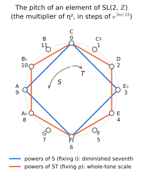

# L-functions and physics

[](https://github.com/rmorleysmith/l-functions-and-physics/actions/workflows/ci.yml)

Where Dirichlet L-functions, the Riemann zeta function and their characters turn up in the physical
world, and how far they can be used to model it: lattices and crystals, waves and diffraction, light and
sound. These are short notes by Richard Morley-Smith, each with figures, a PDF and a script that checks
every number it states.

<p align="center">
  
</p>

## Notes

| | Note | What it shows | PDF |
|---|---|---|---|
| 01 | [The twelve characters of the modular group](notes/01-twelve-tones/twelve-tones.tex) | `SL(2, ℤ)` has exactly twelve characters, the powers of the multiplier of `η² = Δ^{1/12}`. The resulting pitch map is an exact dictionary with the twelve-tone scale: `T` a semitone, the stabilisers of `i` and `ρ` the diminished seventh and the whole-tone scale, the circle of fifths a Galois automorphism of `ℚ(ζ₁₂)`. Proved in Lean. Why musicians use twelve is a separate, acoustic fact. | [pdf](pdf/twelve-tones.pdf) |
| 02 | [Quadratic characters, lattices and waves](notes/02-characters-and-waves/characters-and-waves.tex) | Quadratic characters count the plane waves of equal frequency on the nine class-number-one lattices. Their L-functions give lattice energies: the square ionic crystal's Madelung constant is `4(√2 − 1)·abs(ζ(½))·L(½, χ₋₄) = 1.6155…`. Their Gauss sums govern Talbot diffraction and Schroeder's acoustic diffusers. | [pdf](pdf/characters-and-waves.pdf) |
| 03 | [How many colours in the rainbow?](notes/03-light/light.tex) | Seven is Newton's musical convention, and the diatonic steps do not match the colour bands. Hydrogen's frequency ratios are exactly rational: the Lyman series spans `4/3`, the Balmer series `9/5`. | [pdf](pdf/light.pdf) |

<p align="center">
  
  
</p>

## How the statements are graded

Every note ends with a table that grades each statement it makes:

| Grade | Meaning |
|---|---|
| **lean** | Proved in Lean 4 with Mathlib, in [morley-smith-formal](https://github.com/rmorleysmith/morley-smith-formal). |
| **classical** | A published theorem, cited. |
| **computed** | Checked numerically by a script in [`scripts/`](scripts). The script asserts it and fails if it stops holding. |
| **convention** | A human choice, not a fact about nature. |
| **open** | A question or working hypothesis, not a result. |

This repository models; it does not claim to settle open problems. The Riemann hypothesis and its
relatives appear here only as context. A symmetry about the critical line, or a physical quantity
evaluated on it, says nothing about where the zeros are.

## Reproduce

```sh
make venv     # Python 3.14 virtual environment with the pinned packages in requirements.txt
make check    # run every script: assert each number, redraw every figure in figures/
make pdf      # build the notes (needs TeX Live with latexmk)
```

Continuous integration runs `make check` and builds the PDFs on every push. Tagged releases carry the
PDFs.

## Layout

```
notes/      one folder per note (LaTeX); notes/preamble.tex is shared
scripts/    one script per note; each begins with what it computes, shows, and does not claim
figures/    generated by the scripts (PDF for the notes, SVG for the web)
pdf/        the built notes
```

## Related repositories

- [morley-smith-formal](https://github.com/rmorleysmith/morley-smith-formal): the Lean proofs, including
  the characters of `SL(2, ℤ)` used in note 01 (`tau-track/TauTrack/Tones`).
- [fugue](https://github.com/rmorleysmith/fugue): the audit of the June 2026 exploration from which this
  work grew.

## How AI was used

The ideas and questions are Richard Morley-Smith's: which connections to look for, and what to test.
Claude (Anthropic), through Claude Code, writes the scripts, figures, notes and Lean proofs from the
author's direction, searches the literature for the classical results, and checks each claim. Checking
does not rely on trusting the AI. The Lean theorems are verified by the Lean kernel. The scripts assert
every number they report and run in CI. The classical results cite their sources.

## Cite and licence

Cite with the metadata in [`CITATION.cff`](CITATION.cff) (GitHub's "Cite this repository" button).
Code: Apache-2.0 ([`LICENSE-CODE`](LICENSE-CODE)). Notes, text and figures: CC-BY-4.0
([`LICENSE-TEXT`](LICENSE-TEXT)).
