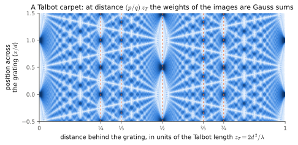
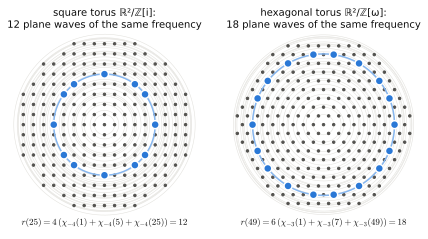
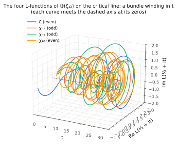
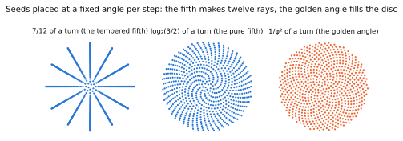
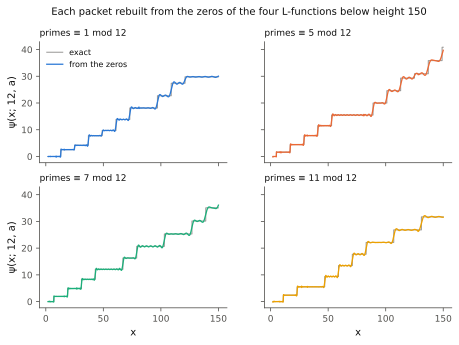
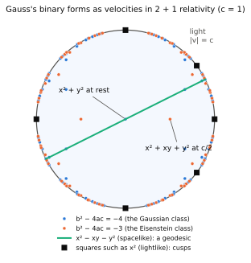
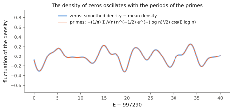
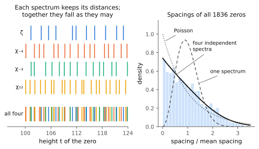
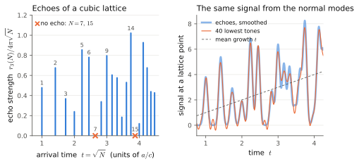
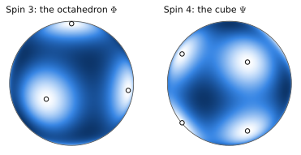

# L-functions and physics

[](https://github.com/rmorleysmith/l-functions-and-physics/actions/workflows/ci.yml)
[](https://doi.org/10.5281/zenodo.24406415)

Where Dirichlet L-functions, the Riemann zeta function and their characters appear in the physical
world, and how they model it: lattices and crystals, waves and diffraction, light and sound, particles
and spacetime. Short notes by Richard Morley-Smith, each with figures, a PDF and a script that checks
every number it states.

<p align="center">
  
</p>

## Where to start

- **Five minutes.** [Note 11](pdf/four-relations.pdf) (five pages): four relations for a cubic lattice of impulses, each stated in
  one line and graded as proved, classical, computed or open.
- **Anomaly cancellation.** [Note 06](pdf/number-theoretic-standard-model.pdf), section 1, with the Lean file
  [`Hypercharge`](https://github.com/rmorleysmith/morley-smith-formal/tree/main/MorleySmithFormal/Hypercharge): for
  quantised hypercharge the gauge conditions of one generation are Fermat's cubic (Lohitsiri and Tong), with the
  explicit list of solutions.
- **Numerics.** [Note 09](pdf/zeros-as-energy-levels.pdf) (the explicit formula as a trace formula, to `2 × 10⁻¹⁰`)
  and [note 02](pdf/characters-and-waves.pdf) (the Madelung constant of the square ionic crystal as a product of
  L-values).
- **Lean.** The statements are in [morley-smith-formal](https://github.com/rmorleysmith/morley-smith-formal).
- **What is open.** Each note ends with a status table. The programme of note 06 is a working hypothesis with five
  questions; the notes around it are classical mathematics and physics, checked.

## Notes

| | Note | What it shows | PDF |
|---|---|---|---|
| 01 | [The twelve characters of the modular group](notes/01-twelve-tones/twelve-tones.tex) | `SL(2, ℤ)` has exactly twelve characters, the powers of the multiplier of `η² = Δ^{1/12}`. The resulting pitch map `SL(2, ℤ) → ℤ/12` is the abelianisation, with an explicit formula, proved in Lean. Read as pitch classes (a reading canonical up to the four automorphisms of `ℤ/12`), the stabilisers of `i` and `ρ` are the diminished seventh and the whole-tone scale, and the circle of fifths is a Galois automorphism of `ℚ(ζ₁₂)`. The musical twelve has a second, acoustic origin, `7/12 ≈ log₂(3/2)`. | [pdf](pdf/twelve-tones.pdf) |
| 02 | [Quadratic characters, lattices and waves](notes/02-characters-and-waves/characters-and-waves.tex) | Quadratic characters count the plane waves of equal frequency on the nine class-number-one lattices. Their L-functions give lattice energies: the square ionic crystal's Madelung constant is `−4(√2 − 1)·ζ(½)·L(½, χ₋₄) = 1.6155…` (ζ(½) is negative). Their Gauss sums govern Talbot diffraction and Schroeder's acoustic diffusers. | [pdf](pdf/characters-and-waves.pdf) |
| 03 | [Light and number: Newton's rings, Balmer's formula and Planck's law](notes/03-light/light.tex) | Three measurements of light and the arithmetic inside them, with the dates of each. Newton measured the period of yellow light (571 nm) and described the spectrum by a musical string; Young read his numbers as frequencies. Balmer, a teacher of mathematics, found the lines of hydrogen as one number times `9/5, 4/3, 25/21, 9/8`, 28 years before Bohr. Planck's law is a count of the tones of a cavity, which are the sums of three squares (Legendre, Gauss), times Euler's `Σ 1/n⁴ = π⁴/90` of 1735. In Dirichlet's language each tone is weighted by a class number and the energy of the box is `(hc/L)[(8π⁵/15)τ⁴ − 2τ + Z(2)/(2π³)]` with Epstein's zeta function; in Hodge's, the tones are the eigenforms of `⋆d`. A closing section asks what these authors were reaching for. Nothing in it is new. | [pdf](pdf/light.pdf) |
| 04 | [What an L-function is, and what it looks like](notes/04-what-an-l-function-is/what-an-l-function-is.tex) | Each prime is a tone of frequency `log p`, and to the right of the critical strip their sum is the logarithm of the function. On the critical line, `L(½ + it)` winds through the origin at every zero. The four L-functions of `ℚ(ζ₁₂)` form a bundle of curves in `t`. Hardy's Z-functions locate the zeros. For the newform of level 11 the functional equation and the reality on the critical line are proved in Lean. | [pdf](pdf/what-an-l-function-is.pdf) |
| 05 | [The golden ratio in the modular world and in physics](notes/05-golden-ratio/golden-ratio.tex) | φ is the number fractions approximate least well (Hurwitz), which accounts for phyllotaxis. It appears exactly in two families. Hurwitz's constant `√5` is twice the height of the shortest closed geodesic on the modular surface, of length `4 log φ` (the bound is proved in Lean). `X(5)` is an icosahedron whose cusps sit at `z⁵ = φ⁻⁵, −φ⁵` in Klein's coordinate, and the icosahedron corresponds to `E8` (McKay), whose Ising masses have `m₂/m₁ = φ` (Zamolodchikov; observed 2010). | [pdf](pdf/golden-ratio.pdf) |
| 06 | [Towards a number-theoretic standard model](notes/06-number-theoretic-standard-model/number-theoretic-standard-model.tex) | Four exact facts, then a working hypothesis and five questions. For one generation with quantised hypercharge the gauge anomaly conditions are Fermat's cubic, and its trivial solutions are the observed hypercharges (Lohitsiri–Tong); the explicit list of solutions is proved in Lean here, for three colours and for any number `N` of colours, and the gravitational consequence for three colours is in [Physlib](https://github.com/leanprover-community/physlib). The solutions are the three rational points of an elliptic curve of conductor 27, whose L-function is that of `η(3z)²η(9z)²` and does not vanish at its centre. The roots of SU(3) colour are the units of the Eisenstein integers. The fields are blind to a `ℤ/6`, and `PSL(2, ℤ)^ab = ℤ/6`. The model is chiral; characters have a parity and modular forms two conjugate Hodge types. | [pdf](pdf/number-theoretic-standard-model.pdf) |
| 07 | [Impulses, packets and spectra](notes/07-impulses-packets-spectra/impulses-packets-spectra.tex) | The primes as a train of impulses. The four characters mod 12 split them into four orthogonal packets, losslessly (a Hadamard matrix, with energy conserved). The L-function is each packet's transfer function. The explicit formula rebuilds each packet from the zeros, and the zeros, played together, ring at the logarithms of the prime powers (Landau). Primes and zeros are a Fourier pair. | [pdf](pdf/impulses-packets-spectra.pdf) |
| 08 | [The speed of light, the light cone and spheres](notes/08-light-cone-and-spheres/light-cone-and-spheres.tex) | The digits of c record a choice of units; its role is to make the light cone a quadratic form. Light in a box: for squarefree index the degeneracy of a mode is a multiple of an L-value (Gauss, Dirichlet). Gauss's binary forms are integer relativity in 2+1 dimensions: the Gaussian and Eisenstein forms move apart at exactly c/2, the nine class-number-one forms have speeds from 0 to `√1601/42`, and class numbers count particles on a mass shell. Lorentz boosts act on the sky as Möbius maps. | [pdf](pdf/light-cone-and-spheres.pdf) |
| 09 | [The zeros as energy levels](notes/09-zeros-as-energy-levels/zeros-as-energy-levels.tex) | All 9511 zeros of ζ in a window near `t = 10⁶`, each simple and on the critical line. Their density is a mean term plus one oscillation per prime power (the form of Gutzwiller's trace formula), verified to `2 × 10⁻¹⁰`. At short range they are observed to repel like the eigenvalues of random Hermitian matrices; at long range their rigidity is Berry's sum over prime powers, to `0.002`. The primes are spaced like a Poisson process. The zeros of the four L-functions of `ℚ(ζ₁₂)` are consistent with four independent spectra (a conjecture of Bogomolny and Leboeuf). | [pdf](pdf/zeros-as-energy-levels.pdf) |
| 10 | [Spheres: echoes, multipoles and rotations](notes/10-spheres/spheres.tex) | A flash at every site of a cubic lattice returns as echoes at the times `√N`; for squarefree `N` each is as loud as `L(1, χ_D)/ζ(2)`, and there is none at `N = 4^a(8b + 7)`. The shape of a lattice shell is a coefficient of a modular form (`η(z)²η(2z)⁷η(4z)²` in space), and its square is a central L-value (Waldspurger within a class of `N`; one constant across classes is computed). The crystal field of a cubic lattice is the nearest-neighbour field times `0.888064766…`. In four dimensions shells are as round as chance allows (Deligne). On the three-sphere, the spin states fixed by the 24 Hurwitz units (Klein's octahedron and cube) are counted by the newforms of level 2. Six rotations from the quaternions of norm 5 mix the sphere at the Ramanujan bound `2√5`; they are gates for a quantum bit. | [pdf](pdf/spheres.pdf) |
| 11 | [Four relations for a cubic lattice of impulses](notes/11-four-relations/four-relations.tex) | The results of notes 08 and 10 on the cubic lattice as four lines for one system, heard from one site. Poisson duality: echoes and tones carry the same integers, and by Schiemann's theorem that list determines the cubic lattice up to rotation: among flat tori in three dimensions, in the words of Kac's title, one can hear its shape (with Milnor's 16-dimensional tori, where one cannot). Echo strength: `E_N = L(1, χ_D)/ζ(2)`, which is also the multiplicity of a ring in the powder diffraction pattern of a cubic crystal. Shell anisotropy: `a(N)²/N^{9/2} = L(5, F ⊗ χ_D)/L(5, F ⊗ χ₋₄)`. Empty shells: no echo at `N = 4^a(8b + 7)` (half proved in Lean). With a dated record of whose theorems these are. | [pdf](pdf/four-relations.pdf) |
| 12 | [Lattice metrics and the cosmological-term functional of gravity from entropy](notes/12-lattice-divergence/lattice-divergence.tex) | Bianconi's theory of gravity from entropy has an emergent cosmological term proportional to `Tr(𝒢 − I − ln 𝒢)`. On the normalised Gram matrices of plane lattices this functional is `2 cosh δ − 2`, with `δ` the hyperbolic distance between the points `z`, `w` of the upper half-plane; for a change of basis `γ ∈ SL(2, ℤ)` of trace `t` it is at least the discriminant `t² − 4`, and at least `5` for hyperbolic `γ` (proved in Lean). Dirichlet's class number formula expresses the ratio of the geodesic length to `√(t² − 4)` through `L(1, χ_D)`. `½ k_BT` times the functional is the mean work dissipated in a sudden switch of a harmonic trap between the two thermal covariances. | [pdf](pdf/lattice-divergence.pdf) |
| 13 | [Speed, spread and swirl: motion on a lattice](notes/13-speed-spread-swirl/speed-spread-swirl.tex) | Special relativity, viscous flow and swirling flow studied with objects of the earlier notes. Shapes of based lattices are four-velocities, and the functional `S` of note 12 is twice the relativistic kinetic energy per rest energy; the square frame moved by integer Lorentz transformations reaches exactly the energies `½ n mc²` with `n` and `n + 4` sums of two squares (Lean); on its axis, `n` golden boosts have speed `√5 F_4n / L_4n`. Burgers' equation from a lattice of explosions is solved through the theta function of the lattice: Voronoi cells, then the slowest tone. Exact flows in a periodic box built on one circle or sphere `|k|² = N` form spaces of dimension `r₂(N)` (plane) and `r₃(N)` (Beltrami flows of one handedness, space), with `r₃(N) = (24/π)√N L(1, χ_D)` for squarefree `N ≢ 7 mod 8`. | [pdf](pdf/speed-spread-swirl.pdf) |

<p align="center">
  
  
</p>

<p align="center">
  
  
</p>

<p align="center">
  
  
</p>

<p align="center">
  
  
</p>

<p align="center">
  
  
</p>

## Reusable derivations

[`DERIVATIONS.md`](DERIVATIONS.md) indexes every derivation the notes rely on. Each entry gives the
statement, its meaning in physical terms, and the script or Lean file that checks it.

## How the statements are graded

Every note ends with a table that grades each statement it makes:

| Grade | Meaning |
|---|---|
| **lean** | Proved in Lean 4 with Mathlib, in [morley-smith-formal](https://github.com/rmorleysmith/morley-smith-formal). |
| **classical** | A published theorem, cited. |
| **physics** | A published derivation or measurement in physics, cited. |
| **computed** | Checked numerically by a script in [`scripts/`](scripts). The script asserts it and fails if it stops holding. |
| **convention** | A human choice of units or names. |
| **open** | A question, conjecture or working hypothesis. |

The notes model physical phenomena with L-functions and their characters. Open problems such as the
Riemann hypothesis enter as context and, where a result depends on them, as stated hypotheses.

## Reproduce

```sh
make venv     # Python 3.14 virtual environment with the pinned packages in requirements.txt
make check    # run every script: assert each number, redraw every figure in figures/
make pdf      # build the notes (needs TeX Live with latexmk)
```

Continuous integration runs `make check` and builds the PDFs on every push. Tagged releases carry the
PDFs.

## Layout

```
notes/      one folder per note (LaTeX); notes/preamble.tex is shared
scripts/    one script per note; each begins with what it computes and what it shows; lfunctions.py is shared
figures/    generated by the scripts (PDF for the notes, SVG for the web)
pdf/        the built notes
```

## Related repositories

- [morley-smith-formal](https://github.com/rmorleysmith/morley-smith-formal): the Lean proofs. Cited here:
  the twelve characters of `SL(2, ℤ)` and the pitch formula (note 01, `tau-track/TauTrack/Tones`); the
  functional equation of the newform of level 11 (notes 02 and 04,
  `tau-track/TauTrack/ElevenFunctionalEquation`); the least displacement `4 log φ` of a hyperbolic element and
  `tanh d(i, ρ) = ½` (notes 05 and 08, `MorleySmithFormal/ModularSystole`); the hypercharges from Fermat's
  theorem for cubes (note 06, `MorleySmithFormal/Hypercharge`); the empty shells (note 11,
  `MorleySmithFormal/SilentShells`); the divergence of lattice metrics (note 12,
  `MorleySmithFormal/LatticeMetricDivergence`); the Fermat cubic modulo primes `p ≡ 2 (mod 3)` (note 06,
  `MorleySmithFormal/FermatCubicModP`); the energies of the square frame (note 13,
  `MorleySmithFormal/SquareFrameEnergies`); and, as accompanying files without a Comparator-checked statement, the Hodge
  decomposition of the parabolic cohomology of `SL(2, ℤ)` (note 06, `tau-track/TauTrack/Cohomology`).
- [fugue](https://github.com/rmorleysmith/fugue): the audit of the June 2026 exploration from which this
  work grew.

## How AI was used

The questions are Richard Morley-Smith's: which connections to look for, and what to test. Claude (Anthropic),
through Claude Code, found the classical results in the literature, chose the precise statements, and wrote the
scripts, figures, notes and Lean proofs under the author's direction. Three things do not depend on trusting the
AI: the Lean kernel verifies the theorems, the scripts assert every number they report and run in CI, and each
classical result cites its source. The bibliographic data of the references were checked against Crossref, arXiv
or the publisher; where a source was cited without being read, the `formalization.yaml` of the Lean result says
so. The notes were reviewed adversarially in November 2026 and corrected; the changes are in
[`CHANGELOG.md`](CHANGELOG.md).

## Cite and licence

Cite with the metadata in [`CITATION.cff`](CITATION.cff) (GitHub's "Cite this repository" button). Every
release is archived on Zenodo: [10.5281/zenodo.24406415](https://doi.org/10.5281/zenodo.24406415) (all versions).
Code: Apache-2.0 ([`LICENSE-CODE`](LICENSE-CODE)). Notes, text and figures: CC-BY-4.0
([`LICENSE-TEXT`](LICENSE-TEXT)).
